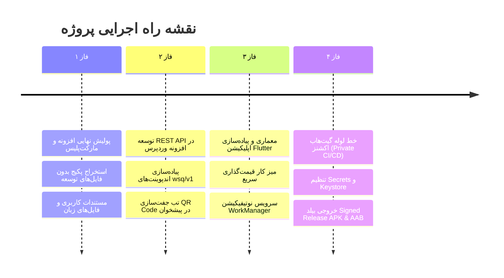

# مستند جامع و ارتقایافته نقشه راه اجرایی (Master Implementation Plan)
## افزونه ووکامرس استعلام قیمت (WooCommerce Smart Quote) + اپلیکیشن موبایل اندروید اختصاصی مدیریت

---

## ۱. مرور اجرایی و معماری کلان (Executive Summary)

این سند نقشه راه جامع، معماری فنی و جزئیات پیاده‌سازی دو جزء اصلی اکوسیستم **WooCommerce Smart Quote (WSQ)** را تشریح می‌کند:

```mermaid
flowchart TD
    subgraph WordPress_Store ["اکوسیستم فروشگاهی وردپرس / ووکامرس"]
        direction TB
        WSQ_Plugin["افزونه WooCommerce Smart Quote v1.0.0"]
        HPOS_DB[("پایگاه داده HPOS و جداول سفارشی")]
        mPDF_Engine["موتور صدور پیش‌فاکتور رسمی PDF (فونت وزیرمتن)"]
        Messengers["ماژول پیام‌رسان‌های ایرانی (بله و ایتا)"]
        REST_API["کنترلر امن WSQ REST API (wsq/v1)"]
        
        WSQ_Plugin --> HPOS_DB
        WSQ_Plugin --> mPDF_Engine
        WSQ_Plugin --> Messengers
        WSQ_Plugin --> REST_API
    end

    subgraph Android_App ["اپلیکیشن همراه اندروید (ویژه مدیران و کارشناسان فروش)"]
        direction TB
        Scanner["اسکنر سریع جفت‌سازی (QR Code Pairing)"]
        Local_DB[("پایگاه داده محلی آفلاین (Hive)")]
        Pricing_Desk["میز کار قیمت‌گذاری سیار (Pricing Desk)"]
        WorkManager["سرویس پس‌زمینه WorkManager (بدون نیاز به فایربیس)"]
        Notification["سیستم نوتیفیکیشن محلی سیستم‌عامل"]
        
        Scanner --> Local_DB
        Pricing_Desk --> Local_DB
        WorkManager --> Notification
    end

    subgraph CI_CD ["مخزن خصوصی گیت‌هاب (Private Repo CI/CD)"]
        GH_Actions["GitHub Actions Workflow"]
        Secrets_Vault["Keystore & Sign Secrets"]
        Artifacts["Signed Release APK & AAB"]
        
        GH_Actions --> Secrets_Vault
        GH_Actions --> Artifacts
    end

    %% Communications
    REST_API <== "رمزنگاری دوجانبه HTTPS (Bearer Token)" ==> Android_App
    WorkManager -. "استعلام دوره‌ای (Polling هر ۱۵ دقیقه)" .-> REST_API
    GH_Actions ==> "بیلد، امضای خودکار و خروجی" ==> Android_App
```

---

## ۲. تصمیمات قطعی معماری و پاسخ به سوالات باز (Design Decisions)

بر اساس دستورالعمل کاربر مبنی بر اتخاذ بهترین تصمیمات فنی و کاربردی، راهکارهای زیر تثبیت شدند:

| موضوع | تصمیم قطعی | دلیل فنی و مزیت تجاری |
|---|---|---|
| **پایه کد افزونه** | توسعه کاملاً مستقل و نیتیو (Plan A مستقل) | عدم وابستگی به هیچ افزونه شخص ثالث خارجی (نظیر YITH)، مالکیت معنوی ۱۰۰٪ قانونی جهت عرضه رسمی در راست‌چین و ژاکت، سازگاری کامل با معماری مدرن HPOS ووکامرس. |
| **پیام‌رسان‌ها** | پشتیبانی همزمان و کامل از **بله** و **ایتا** | پوشش حداکثری مخاطبان داخلی با سیستم روتینگ هوشمند بر اساس دسته‌بندی محصولات و ارسال آنی پیش‌فاکتور ضمیمه. |
| **فرمت پیش‌فاکتور PDF** | پیش‌فاکتور رسمی تجاری مطابق با استانداردهای سازمان امور مالیاتی | جدول استاندارد اقلام، محاسبه مالیات بر ارزش افزوده، شماره سریال، بارکد دوبعدی رهگیری، مهر و امضای دیجیتال و فونت زیبای وزیرمتن. |
| **فناوری اپلیکیشن همراه** | فریم‌ورک **Flutter (Dart 3.5+)** با رابط کاربری Material 3 | پرفورمنس بسیار بالا، پشتیبانی بومی و بی‌نقص از راست‌چین (RTL)، ساختار مدرن، سازگاری کامل با کامپایل خودکار در خط لوله GitHub Actions. |
| **احراز هویت و اتصال اپلیکیشن** | جفت‌سازی امن یک‌کلیکه از طریق **QR Code** | ادمین بدون نیاز به تایپ رمز عبور یا API Key پیچیده، صرفاً با دوربین گوشی بارکد تولیدشده در پنل وردپرس را اسکن می‌کند. تبادل توکن با الگوریتم HMAC-SHA256 و کلید رمزنگاری محلی انجام می‌شود. |
| **نوتیفیکیشن‌ها و هشدارها** | سرویس پس‌زمینه **Android WorkManager Polling** | **۱۰۰٪ مقاوم در برابر تحریم و فیلترینگ**؛ بدون وابستگی به Google Firebase Cloud Messaging (FCM) یا سرورهای پوش شخص ثالث. استعلام کم‌مصرف در پس‌زمینه و صدور نوتیفیکیشن بومی اندروید. |
| **استقرار و بیلد موبایل** | پایپ‌لاین **GitHub Actions در ریپازیتوری خصوصی** | خودکارسازی صفر تا صد فرایند کامپایل، تست، امضای دیجیتال (Signing with Keystore) و خروجی نسخه‌های تفکیکی APK و AAB بدون به اشتراک‌گذاری کلیدهای خصوصی. |

---

## ۳. فازبندی تفصیلی پروژه (Detailed Implementation Phases)



---

### فاز ۱: پولیش نهایی افزونه وردپرس و استانداردسازی مارکت‌پلیس

1. **پالایش پکیج توزیع (`build-package.php`)**:
   - حذف خودکار تمام فایل‌های تستی، لاگ‌ها، پیکربندی‌های PHPStan/PHPUnit در کتابخانه mPDF، فونت‌های استفاده‌نشده و کدهای توسعه موقت.
   - ایجاد بسته نهایی `woo-smart-quote-1.0.0.zip` با ساختار معتبر و حجم بهینه کمتر از ۲.۷ مگابایت.
2. **بررسی استانداردهای امنیتی وردپرس**:
   - اعمال نانس در تمام درخواست‌های AJAX و متدهای عمومی (`check_ajax_referer`).
   - کنترل سطح دسترسی ادمین (`current_user_can('manage_woocommerce')`).
   - رعایت دقیق فرار دادن خروجی‌ها (`esc_html`, `esc_attr`, `esc_url`, `wp_kses_post`) و پاکسازی کامل ورودی‌ها.
3. **بومی‌سازی و بسته‌های زبان (i18n)**:
   - همگام‌سازی و تولید فایل‌های `languages/woo-smart-quote.pot`، `woo-smart-quote-fa_IR.po` و کامپایل `woo-smart-quote-fa_IR.mo`.
4. **مستندات و کتابچه راهنما**:
   - تدوین راهنمای جامع نصب و پیکربندی شامل مراحل دریافت توکن ربات بله، ربات ایتا، تنظیمات مهر فروشگاه و شورت‌کدها به فرمت Markdown و HTML شکیل.

---

### فاز ۲: طراحی و پیاده‌سازی REST API اختصاصی افزونه (`WSQ_REST_API`)

کنترلر جدید `woo-smart-quote/includes/class-wsq-rest-api.php` بر بستر معماری استاندارد WP REST API و با پیشوند `wsq/v1` تعریف می‌شود:

#### ۱. اندپوینت‌های API:

```
POST   /wp-json/wsq/v1/auth/pair
       ← ورودی: { "pairing_token": "...", "device_name": "Galaxy S24", "device_id": "..." }
       → خروجی: { "token": "wsq_sec_...", "store_name": "...", "currency": "IRT", "user_display_name": "..." }

GET    /wp-json/wsq/v1/quotes
       ← پارامترها: page=1&per_page=20&status=pending|priced|approved&search=...
       → خروجی: لیست استعلام‌ها با جزئیات خریدار، تعداد اقلام، تاریخ شمسی، وضعیت و جمع کل.

GET    /wp-json/wsq/v1/quotes/{id}
       ← خروجی: اطلاعات کامل استعلام، اقلام به همراه تصاویر شاخص، یادداشت خریدار و لاگ تغییر قیمت.

POST   /wp-json/wsq/v1/quotes/{id}/price
       ← ورودی: { 
           "items": [ { "item_id": 12, "custom_price": 450000 }, { "item_id": 13, "discount_percent": 10 } ],
           "quote_expiry": "1405-08-15",
           "admin_note": "تخفیف همکاری ۵ درصدی اعمال شد"
         }
       → خروجی: پیش‌فاکتور به‌روزرسانی شده و محاسبه مجدد مجموع قیمت و مالیات.

POST   /wp-json/wsq/v1/quotes/{id}/pdf
       → خروجی: { "pdf_url": "https://example.com/wp-content/uploads/wsq/quote-1024.pdf" }

POST   /wp-json/wsq/v1/quotes/{id}/notify
       ← ورودی: { "channel": "bale" | "eitaa" | "sms", "custom_message": "..." }
       → خروجی: { "success": true, "sent_at": "..." }

GET    /wp-json/wsq/v1/updates?since={unix_timestamp}
       → خروجی فوق‌سریع و سبک برای Polling پس‌زمینه: { "new_quotes_count": 2, "updated_quotes_count": 1, "timestamp": 1729881600 }
```

#### ۲. تب جفت‌سازی در پیشخوان وردپرس (QR Code Pairing Tab):
- در منوی تنظیمات افزونه در تب جدید «اپلیکیشن موبایل»، یک کد QR اختصاصی با انقضای موقت (TTL ۱۰ دقیقه‌ای) نمایش داده می‌شود.
- لیست دستگاه‌های متصل فعال به همراه مدل دستگاه، تاریخ اتصال، آخرین فعالیت و دکمه ابطال دسترسی (Revoke Access) نمایش داده می‌شود.

---

### فاز ۳: معماری اپلیکیشن اندروید مدیر فروشگاه (Flutter Companion)

#### ۱. ساختار ماژولار پروژه (`wsq_companion/`):
```
wsq_companion/
├── lib/
│   ├── core/
│   │   ├── constants/           # تم رنگی، رشته‌ها، فونت وزیرمتن
│   │   ├── network/             # کلاینت Dio، Interceptor توکن، لاگینگ ایمن
│   │   ├── storage/             # مدیریت نشست با flutter_secure_storage و Hive
│   │   └── utils/               # تبدیل تاریخ شمسی (Jalali)، فرمت ارقام فارسی
│   ├── features/
│   │   ├── auth/                # اسکنر QR، ذخیره توکن، اعتبارسنجی
│   │   ├── dashboard/           # کارت‌های آماری، نمودار روند، فیلتر استعلام‌ها
│   │   ├── quote_details/       # مشاهده اقلام، ویرایش قیمت‌ها، اعمال تخفیف
│   │   ├── pdf_preview/         # نمایش داخلی PDF پیش‌فاکتور و اشتراک‌گذاری مستقیم
│   │   └── multi_store/         # انتخاب و سوئیچ بین چند فروشگاه مختلف
│   ├── services/
│   │   ├── background_worker.dart # وظایف WorkManager برای استعلام در پس‌زمینه
│   │   └── notification_service.dart # اعلان‌های بومی اندروید با کانال اختصاصی
│   └── main.dart
├── assets/
│   ├── fonts/                   # Vazirmatn-Regular.ttf, Vazirmatn-Bold.ttf
│   └── images/                  # لوگوی رسمی WSQ
├── pubspec.yaml
└── android/
```

#### ۲. قابلیت‌های کلیدی میز کار قیمت‌گذاری همراه (Mobile Pricing Desk):
- **تنظیم قیمت سریع**: امکان لمس هر ردیف و درج قیمت پیشنهادی یا تخفیف درصدی با کیبورد عددی بهینه‌شده.
- **پیش‌نمایش آنی PDF**: دکمه اختصاصی صدور پیش‌فاکتور و باز کردن داخل اپلیکیشن با امکان ارسال فایل مستقیم به واتساپ، ایتا، بله یا تلگرام.
- **اطلاع‌رسانی یک‌کلیکه به خریدار**: ارسال پیامک یا پیام پیام‌رسان با متن آماده «پیش‌فاکتور شما صادر شد».
- **مدیریت چندفروشگاهی (Multi-Store)**: مدیرانی که چند سایت ووکامرسی دارند می‌توانند بارکد هر سایت را اسکن کرده و با یک کلیک بین فروشگاه‌ها جابجا شوند.

---

### فاز ۴: پایپ‌لاین CI/CD در ریپازیتوری خصوصی گیت‌هاب (GitHub Actions)

با توجه به این‌که سورس کد اپلیکیشن در یک ریپازیتوری خصوصی نگهداری می‌شود، خط لوله کامپایل و امضای امن به شرح زیر پیکربندی می‌گردد:

#### ۱. فایل گردش‌کار: `.github/workflows/build-android.yml`

```yaml
name: Build & Sign Android Companion App

on:
  push:
    branches: [ "main" ]
    tags: [ "v*.*.*" ]
  workflow_dispatch:

jobs:
  build:
    name: Build Signed Android App
    runs-on: ubuntu-latest

    steps:
      - name: Checkout Repository
        uses: actions/checkout@v4

      - name: Set up Java 17
        uses: actions/setup-java@v4
        with:
          distribution: 'temurin'
          java-version: '17'
          cache: 'gradle'

      - name: Set up Flutter SDK
        uses: subosito/flutter-action@v2
        with:
          flutter-version: '3.24.x'
          channel: 'stable'
          cache: true

      - name: Install Dependencies
        run: flutter pub get

      - name: Run Static Analysis & Tests
        run: |
          flutter analyze --no-fatal-infos
          flutter test

      - name: Decode Android Keystore
        env:
          KEYSTORE_BASE64: ${{ secrets.KEYSTORE_BASE64 }}
        run: |
          echo "$KEYSTORE_BASE64" | base64 --decode > android/app/upload-keystore.jks

      - name: Configure Keystore Properties
        env:
          KEYSTORE_PASSWORD: ${{ secrets.KEYSTORE_PASSWORD }}
          KEY_ALIAS: ${{ secrets.KEY_ALIAS }}
          KEY_PASSWORD: ${{ secrets.KEY_PASSWORD }}
        run: |
          cat <<EOF > android/key.properties
          storePassword=$KEYSTORE_PASSWORD
          keyPassword=$KEY_PASSWORD
          keyAlias=$KEY_ALIAS
          storeFile=upload-keystore.jks
          EOF

      - name: Build Signed Universal & Split APKs
        run: |
          flutter build apk --release --split-per-abi
          flutter build apk --release

      - name: Build Signed Android App Bundle (AAB)
        run: |
          flutter build appbundle --release

      - name: Upload APK Artifacts
        uses: actions/upload-artifact@v4
        with:
          name: release-apks
          path: build/app/outputs/flutter-apk/*.apk
          retention-days: 14

      - name: Upload AAB Artifact
        uses: actions/upload-artifact@v4
        with:
          name: release-aab
          path: build/app/outputs/bundle/release/*.aab
          retention-days: 14
```

#### ۲. متغیرهای محرمانه مورد نیاز در ریپازیتوری (GitHub Secrets):
- `KEYSTORE_BASE64`: فایل کی‌استور امضای اندروید به‌صورت استرینگ Base64.
- `KEYSTORE_PASSWORD`: رمز عبور کلیدخانه.
- `KEY_ALIAS`: نام مستعار کلید امضا.
- `KEY_PASSWORD`: رمز عبور اختصاصی کلید.

---

## ۴. طرح تست، کیفیت و معیارهای پذیرش (Quality & Acceptance Criteria)

| حوزه | ابزار ارزیابی | معیار قبولی |
|---|---|---|
| **هسته افزونه وردپرس** | آزمون‌های واحد و یکپارچه‌ساز WP-CLI | ۱۰۰٪ پاس شدن تمام ۸ آزمون خودکار شامل موبایل، اصطکاک، داشبورد و PDF |
| **امنیت اندپوینت‌های REST** | تست نفوذ و ارزیابی هدرها | مسدودسازی کامل درخواست‌ها در صورت فقدان توکن یا نانس، حفاظت در برابر Brute-force |
| **کیفیت و عملکرد Flutter** | `flutter analyze` & `flutter test` | صفر خطای کامپایل، تست‌های واحد فرمت اعداد فارسی و ذخیره‌سازی آفلاین |
| **سازگاری مارکت‌پلیس** | چک‌لیست راست‌چین و ژاکت | عدم وجود فایل‌های گیت و دیباگ در پکیج، حجم کمتر از ۵ مگابایت، فونت‌های استاندارد |
| **بیلد خودکار GitHub Actions** | لاگ‌های اجرای Action | کامپایل موفق Signed APK و AAB در کمتر از ۵ دقیقه و قرارگیری در بخش Artifacts |

---

## ۵. گام بعدی اجرایی

با توجه به تایید رویکرد و جزئیات فوق:
1. ایجاد کنترلر `class-wsq-rest-api.php` و ثبت اندپوینت‌های جفت‌سازی و مدیریت استعلام‌ها در افزونه.
2. افزودن تب جفت‌سازی سریع با کد QR در پیشخوان تنظیمات افزونه.
3. ایجاد پایه پروژه اپلیکیشن Flutter در پوشه اختصاصی همراه با اسکریپت گردش‌کار GitHub Actions.
