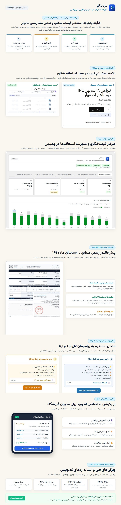

# مستندات و متن صفحه محصول در راست‌چین
## نام محصول: افزونه استعلام قیمت و پیش‌فاکتور رسمی «نرخنگار» (Nerkhnegar)

> **راهنمای فروشنده برای ثبت در پنل راست‌چین:**
> این فایل بر اساس [استانداردهای انتشار محصول در راست‌چین](https://www.rtl-theme.com/blog/%D8%A7%D8%B3%D8%AA%D8%A7%D9%86%D8%AF%D8%A7%D8%B1%D8%AF%D9%87%D8%A7%DB%8C-%D8%A7%D9%86%D8%AA%D8%B4%D8%A7%D8%B1-%D9%85%D8%AD%D8%B5%D9%88%D9%84-%D8%AF%D8%B1-%D8%B1%D8%A7%D8%B3%D8%AA-%DA%86%DB%8C/) در ۵ بخش آماده شده است تا هنگام ثبت یا ویرایش محصول، اطلاعات را مستقیم در فیلدهای پنل کپی کنید.

---

## ۱. مشخصات پایه محصول (Product Metadata)

* **نام برند محصول (تک‌کلمه‌ای):**
  > **نرخنگار** (پیوسته و بدون نیم‌فاصله)
* **عنوان اصلی محصول (Title):**
  > افزونه استعلام قیمت و پیش‌فاکتور رسمی ووکامرس نرخنگار | همراه با اپلیکیشن اندروید، ربات بله و ایتا و قالب ماده ۱۶۹
* **عنوان کوتاه سایدبار (Short Title):**
  > افزونه نرخنگار (استعلام قیمت + پیش‌فاکتور رسمی)
* **نامک محصول (Slug):**
  > `woo-nerkhnegar`
* **دسته‌بندی (Category):**
  > افزونه‌های ووکامرس > مدیریت سفارش‌ها و پیش‌فاکتور > فروش عمده و B2B
* **برچسب‌ها (Tags):**
  > نرخنگار, استعلام قیمت ووکامرس, پیش‌فاکتور رسمی, فاکتور ماده ۱۶۹, اپلیکیشن مدیریت ووکامرس, ربات بله و ایتا, قیمت توافقی, عمده‌فروشی, پیش‌فاکتور PDF, فروش شرکتی ووکامرس

---

## ۲. فیلد «موارد باکس خرید» (Purchase Box Fields)

> **نکته:** ضمانت بازگشت وجه و پشتیبانی ۶ ماهه به صورت خودکار توسط راست‌چین درج می‌شوند. دانلود اپلیکیشن اندروید نیز مستقیماً از پیشخوان وردپرس انجام می‌شود.

1. `فایل نصبی افزونه نرخنگار (zip)`
2. `دفترچه راهنمای کاربری (PDF)`
3. `راهنمای گام‌به‌گام تنظیمات (HTML)`
4. `نکات قبل از نصب (TXT)`
5. `دانلود اپلیکیشن اندروید از پیشخوان`
6. `بروزرسانی خودکار از پیشخوان`
7. `بدون قفل دامنه (مجوز GPL)`

---

## ۳. گزینه‌های انتخابی پنل ثبت محصول

* **نشان‌ها (Badges):**
  > `محصول ایرانی` • `راست‌چین اورجینال` • `سازگار با ووکامرس`
* **امکانات اضافی (Extra Features):**
  > `دارای راهنمای تصویری` • `بدون قفل دامنه (GPL)` • `پشتیبانی تخصصی`
* **نوع طراحی (Design Type):**
  > `واکنش‌گرا (Responsive)` • `طراحی مدرن و فلت`
* **سازگاری با مرورگر (Browser Compatibility):**
  > `Chrome, Firefox, Safari, Edge, Opera`
* **سازگاری با (Platform Compatibility):**
  > `WooCommerce 8.x, WooCommerce 9.x, WordPress 6.x`

---

## ۴. کد توضیحات محصول (ساختار راست‌چین)

```html
<div class="rastchin-product-description" dir="rtl">

  <!-- معرفی محصول (دقیقاً ۲ خط، زیر ۳۵ کلمه) -->
  <h2>معرفی محصول</h2>
  <p>با افزونه «نرخنگار»، مشتریان شما می‌توانند برای کالاهای فروشگاه درخواست استعلام قیمت ثبت کنند.<br>بعد از ثبت قیمت، پیش‌فاکتور رسمی ماده ۱۶۹ صادر شده و در بله یا ایتا برای خریدار ارسال می‌شود.</p>

  <!-- ویژگی‌های اصلی (دقیقاً ۵ مورد - هر ویژگی در یک خط، زیر ۱۰ کلمه) -->
  <h2>ویژگی‌های اصلی</h2>
  <ul>
    <li>صدور پیش‌فاکتور رسمی ماده ۱۶۹ با مهر و امضای فروشگاه</li>
    <li>ارسال مستقیم فایل PDF پیش‌فاکتور در پیام‌رسان بله و ایتا</li>
    <li>اپلیکیشن اندروید برای بررسی و قیمت‌گذاری سریع استعلام‌ها</li>
    <li>سبد استعلام چندقلمی برای خریدهای عمده و شرکتی</li>
    <li>سازگار با ووکامرس ۹ و جداول سفارش HPOS</li>
  </ul>

  <!-- اینفوگرافیک معرفی و کارکرد افزونه -->
  <h2>اینفوگرافیک معرفی و کارکرد افزونه</h2>
  <p></p>

  <!-- لیست کامل ویژگی‌ها -->
  <h2>لیست کامل ویژگی‌ها</h2>
  <ul>
    <li>جایگزینی دکمه «افزودن به سبد خرید» با «استعلام قیمت» برای محصولات بدون قیمت یا کل فروشگاه</li>
    <li>سبد استعلام شناور برای جمع‌آوری چند کالا در یک درخواست واحد</li>
    <li>فرم ثبت مشخصات خریدار با بررسی صحیح بودن شماره موبایل قبل از ارسال</li>
    <li>ثبت هر درخواست به عنوان یک سفارش با وضعیت «درخواست استعلام» در ووکامرس</li>
    <li>جدول قیمت‌گذاری اقلام در صفحه سفارش با محاسبه لحظه‌ای جمع کل</li>
    <li>صدور پیش‌فاکتور PDF با قالب استاندارد ماده ۱۶۹ دارایی و فونت فارسی وزیرمتن</li>
    <li>درج مشخصات ثبتی فروشنده و خریدار (شناسه ملی، کد اقتصادی، شماره ثبت، کد پستی و نشانی)</li>
    <li>محاسبه مالیات بر ارزش افزوده (VAT) و تخفیف روی ردیف‌های پیش‌فاکتور</li>
    <li>نمایش لوگوی فروشگاه و تصویر مهر و امضا در پای پیش‌فاکتور</li>
    <li>قرارگیری لینک و بارکد QR پرداخت آنلاین روی برگه پیش‌فاکتور</li>
    <li>تعیین مهلت اعتبار پیش‌فاکتور با تاریخ شمسی و منقضی شدن خودکار پیشنهادها</li>
    <li>ارسال خلاصه استعلام جدید و فایل PDF به بازوی بله و کانال یا گروه ایتا</li>
    <li>تفکیک گیرنده اعلان‌ها بر اساس دسته‌بندی محصول برای کارشناسان فروش مختلف</li>
    <li>ربات پاسخگوی بله و ایتا برای پیگیری وضعیت استعلام و دریافت پیش‌فاکتور توسط مشتری</li>
    <li>صندوق پیام‌های دریافتی بله و ایتا در پیشخوان وردپرس با امکان پاسخ مستقیم</li>
    <li>ارسال پیامک اطلاع‌رسانی صدور پیش‌فاکتور از طریق فراز اس‌ام‌اس، کاوه‌نگار و سفیر بله</li>
    <li>ارسال ایمیل پیش‌فاکتور همراه با فایل PDF پیوست و دکمه پرداخت آنلاین</li>
    <li>دکمه‌های آماده شروع گفتگو با خریدار در بله، ایتا و واتساپ از داخل صفحه سفارش</li>
    <li>اپلیکیشن اندروید مخصوص مدیر و کارشناس فروش برای بررسی و قیمت‌گذاری استعلام‌ها با موبایل</li>
    <li>اتصال اپلیکیشن موبایل به سایت فقط با اسکن بارکد QR از داخل تنظیمات افزونه</li>
    <li>داشبورد آماری استعلام‌های روزانه و هفتگی، نرخ تبدیل به خرید و نمودار ۱۴ روز اخیر</li>
    <li>ثبت یادداشت مخصوص خریدار روی پیش‌فاکتور و یادداشت داخلی برای همکاران فروش</li>
    <li>محافظت از پوشه فایل‌های PDF در برابر دسترسی مستقیم و پاک‌سازی خودکار فایل‌های قدیمی</li>
    <li>ارسال پیام‌ها در پس‌زمینه با Action Scheduler برای جلوگیری از کند شدن ثبت فرم</li>
    <li>سازگار با جدول سفارش‌های جدید ووکامرس (HPOS) و نسخه‌های PHP 8.1 تا 8.3</li>
    <li>حجم سبک (زیر ۳ مگابایت) همراه با کتابخانه داخلی mPDF بدون نیاز به نصب ابزار جانبی روی سرور</li>
    <li>ارائه شده تحت مجوز GPL وردپرس، بدون قفل دامنه یا نیاز به یون‌کیوب (IonCube)</li>
  </ul>

  <!-- پیش‌نیازها و راهنما -->
  <h2>پیش‌نیازها و راهنما</h2>
  <p>وردپرس ۶.۰ به بالا • ووکامرس ۸.۰ به بالا • PHP 8.1 تا 8.3 (پیشنهادی: 8.2) • فعال بودن ماژول‌های cURL، GD و mbstring روی هاست.</p>
  <p>اپلیکیشن همراه اندروید مستقیماً از بخش «اپلیکیشن همراه» در پیشخوان وردپرس قابل دریافت است.</p>

</div>
```
